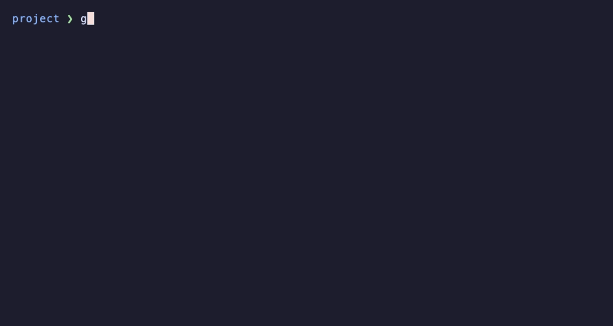
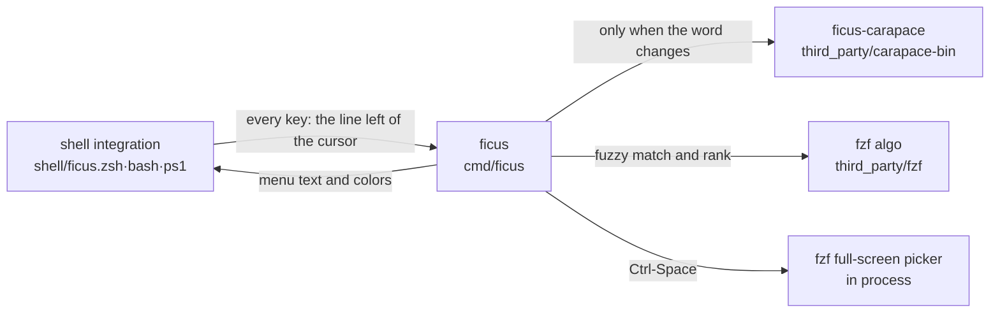

# ficus

A Fig-style **as-you-type completion menu** drawn inside the terminal. It runs on the shell's own facilities, with no GUI window, so it works the same on macOS, Linux and Windows, over SSH and inside tmux.



The recording above (zsh, 24 seconds):

- Typing `git ch` opens a menu of subcommands with descriptions; the first item is highlighted.
- Down picks `checkout`; Tab completes it and opens the next word's menu: branches and tags, grouped.
- Typing `fe` and Enter completes `feature/login`; a second Enter runs the line.
- `ls -` lists the flags with their descriptions.
- Ctrl-Space after `cat ` opens a fuzzy picker with a file preview.

The recording is regenerated from `docs/demo.tape` with [VHS](https://github.com/charmbracelet/vhs): `make demo` (needs `brew install vhs`).

| Shell | Minimum version | How the menu is drawn |
|---|---|---|
| zsh | 5.9 | `POSTDISPLAY` + `region_highlight` (zle draws it), candidates looked up asynchronously (`zle -F`) |
| bash | 4.0 | `bind -x` key handlers + cursor-relative ANSI output |
| PowerShell | PSReadLine 2.x | PSReadLine key handlers + ANSI output |

## Architecture



- **ficus** (`cmd/ficus`, `internal/engine`): parses the line with the shell's grammar (carapace-shlex), gathers candidates, ranks them with fzf's algorithm, and returns the menu in the shell's format. Quoting for each shell on accept happens here too.
- **ficus-carapace** (`cmd/ficus-carapace`): an unmodified carapace-bin build. It knows over 1000 commands but takes about 150 ms to run, so it runs only when the word changes and its result is cached (10 seconds by default). Typing within the same word only fuzzy-filters the cached candidates.
- Candidate sources: in command position, `PATH` executables plus the shell's aliases, functions and builtins; arguments from carapace; for commands carapace does not know, files (or, for a word starting with `-`, the flags read from the command's `--help`); environment variables for `$VAR`; PowerShell's own `TabExpansion2` for cmdlet arguments.

The three projects in `third_party/` (carapace-bin, fzf, fzf-tab) are unmodified git submodules. fzf-tab is reference only and not built (`ficus pick` does the same job in every shell).

## Install

### Linux, macOS

```sh
curl -fsSL https://github.com/leechoonguk/ficus/releases/latest/download/install.sh | sh
```

Downloads this machine's archive from the latest release, verifies it against `checksums.txt`, puts both binaries (`ficus`, `ficus-carapace`) in `~/.local/bin` and runs `ficus setup`. No administrator rights are needed. The same line works on a remote server; nothing has to be set up on the client or in tmux. Environment variables change it: `FICUS_VERSION=v0.1.0` (pin a version), `FICUS_INSTALL_DIR` (install location), `FICUS_SHELLS=zsh,bash` (shells to enable), `FICUS_NO_SETUP=1` (skip enabling).

From a clone, `make install` does the same without building anything (`v=vX.Y.Z` pins a version, `PREFIX`/`SHELLS` as below); `make build && make install` installs your own build instead.

### Ubuntu, Debian (.deb)

```sh
curl -fsSLO https://github.com/leechoonguk/ficus/releases/latest/download/ficus_amd64.deb   # ARM: ficus_arm64.deb
sudo apt install ./ficus_amd64.deb
ficus setup          # as your user (no sudo)
```

The package installs only the binaries, in `/usr/bin`. Shell startup files belong to each user, so each user runs `ficus setup`. Fedora and others: `ficus_amd64.rpm` in the same place.

### Windows (PowerShell)

```powershell
irm https://github.com/leechoonguk/ficus/releases/latest/download/install.ps1 | iex
```

Installs into `%LOCALAPPDATA%\Programs\ficus`, adds it to the user PATH, and enables ficus in the `$PROFILE` of PowerShell 7 (`pwsh`) and Windows PowerShell 5.1. No administrator rights are needed. The executables are not signed, so SmartScreen or antivirus software may warn the first time.

### Update

```sh
ficus update           # install the latest release over this ficus and ficus-carapace
ficus update --check   # only report whether a newer release exists
```

It finds the latest release, downloads the same archive the install scripts use, checks it against `checksums.txt` and replaces both binaries where this `ficus` is installed (`~/.local/bin`, `%LOCALAPPDATA%\Programs\ficus`, a custom `FICUS_INSTALL_DIR`). Startup files need no change; new terminals load the new version. A package install (`/usr/bin`) is updated with its package; a source build (`make build && make install`) with `git pull && make build && make install`, or replaced with the release by `ficus update --force`. Releases up to v0.1.0 have no `update`: run the install line once more.

### Enabling it in shells: `ficus setup`

`ficus setup` finds the supported shells on this machine (zsh 5.9+, bash 4+, `pwsh`, and `powershell` on Windows) and appends the block below to each startup file. Every new shell (after login or reboot too) then loads ficus. ficus is not a resident process, so nothing runs at boot. To choose the shells: `ficus setup --shells zsh,bash`.

| Shell | Startup file | Line added |
|---|---|---|
| zsh | `${ZDOTDIR:-~}/.zshrc` | `if [ -x '…/ficus' ]; then eval "$('…/ficus' init zsh)"; fi` |
| bash | `~/.bashrc`, and the login shell's `~/.bash_profile` (or `.bash_login`/`.profile`) when it does not read `.bashrc` | `if [ -n "$BASH_VERSION" ] && [ -x '…/ficus' ]; then eval "$('…/ficus' init bash)"; fi` |
| PowerShell | `$PROFILE` | `if (Test-Path -LiteralPath '…/ficus') { Invoke-Expression (& '…/ficus' init pwsh \| Out-String) }` |

The block is wrapped in `# >>> ficus >>>` … `# <<< ficus <<<`; running setup again replaces it without duplicating it. It also appends the directory ficus is in to `PATH` when it is not there yet (a fresh macOS has no `~/.local/bin` on `PATH`), so `ficus` works as a command in new terminals. Installed before v0.2.1? Run `~/.local/bin/ficus setup` once to get that line. The block holds the path `ficus setup` ran as (`/usr/bin/ficus`, a Homebrew link, …), so upgrades keep working. With the binary gone it does nothing, so the shell still starts and the exit status is unchanged. zsh is asked where its startup file is (a `ZDOTDIR` set in `~/.zshenv` counts). The block must come after plugin managers such as oh-my-zsh: if you later add plugins at the end of the file, run `ficus setup` again to move the block back to the end.

`ficus setup --remove` undoes it. It deletes only the block and the blank line and final newline setup added, so **the file is byte-for-byte what it was before** (CRLF files and files without a final newline included; lines another program appended after the block stay), and it deletes a startup file setup created if nothing else was added to it. A symlinked startup file stays a symlink. If any file has a broken block (a start marker without an end marker, …), both setup and removal leave that file alone and report it, and setup stops before changing any other file.

Several versions of a shell read the same startup file (macOS's `/bin/bash` 3.2 and Homebrew's bash 5 both read `~/.bashrc`). An unsupported version (bash below 4, zsh below 5.9, PowerShell without PSReadLine) **skips the block silently**, and the rest of the file runs as before. Detection only adds the block for shells with a supported version, so with only macOS's bash 3.2 `~/.bashrc` is left alone; after installing bash 5, run `ficus setup` again.

### Uninstall

| Installed with | Remove with |
|---|---|
| `install.sh` | `ficus setup --remove && rm ~/.local/bin/ficus ~/.local/bin/ficus-carapace` |
| `.deb` | `ficus setup --remove && sudo apt remove ficus` |
| `install.ps1` | `ficus setup --remove`, then delete `%LOCALAPPDATA%\Programs\ficus` |
| `make install` (either way) | `make uninstall` |

The candidate cache is the `ficus` folder in the user cache directory (macOS `~/Library/Caches/ficus`, Linux `~/.cache/ficus`, Windows `%LOCALAPPDATA%\ficus`) and can be deleted.

### Build from source

Needs git, make and curl (or wget). Go is optional: `make` uses the `go` on PATH when it is Go 1.21 or newer, letting it fetch the `go.mod` version itself (`GOTOOLCHAIN=auto`, even where the distribution sets `local`), and otherwise downloads the `go.mod` version from go.dev once, checks its SHA-256 and keeps it in `.cache/` of the clone (`scripts/go.sh`). The submodules are fetched on the first build. `make install` never builds: it installs what `make build` left in `bin/`, and with nothing there the latest release, printing which.

```sh
git clone https://github.com/leechoonguk/ficus && cd ficus
make            # bin/ficus, bin/ficus-carapace
make test
make install    # bin/ to ~/.local/bin (PREFIX=... to change) + ficus setup (SHELLS="zsh bash" to choose)
make uninstall  # ficus setup --remove + delete the binaries and the cache
make dist       # every platform's release files into dist/ (needs GoReleaser; publishes nothing)
make verify     # the gate before a commit: harness checks + gofmt/vet + tests
```

### Releasing

The version is the git tag (`vX.Y.Z`) and nothing else, and tags are made only by `make release`.

```sh
make release bump=patch DRY_RUN=1   # check only: shows the next version and the commits, publishes nothing
make release bump=patch             # patch (fixes) | minor (new features) | major (users must change something)
```

After `make verify`, `scripts/release.sh` does the following in order and stops at the first failure:

1. Checks the commit: on `main`, a clean worktree, equal to `origin/main`, and the `ci` workflow passed for it (it waits while CI runs).
2. Computes the next version from the last tag (`v0.1.0` + patch → `v0.1.1`) and lists the commits going out.
3. Pushes the tag; GitHub Actions (`release.yml`) builds 6 platforms with GoReleaser (`.goreleaser.yaml`) and uploads the archives, `.deb`/`.rpm`, `checksums.txt`, `install.sh` and `install.ps1` to Releases (about 8 minutes). It waits for that.
4. Checks that every file was uploaded.
5. Runs `verify-release.yml` for the version, which installs it for real on Ubuntu and macOS (`install.sh`), from the `.deb`, and on Windows (`install.ps1` in PowerShell 7 and 5.1), and checks enabling, completion and removal (about 3 minutes).

`make unrelease v=vX.Y.Z` removes a bad release (the GitHub release and its tag; `releases/latest` then points at the previous release). Never reuse a published version number; fix forward with the next one. Release notes are the commit subjects since the last tag (without `docs:` and `test:`), so write subjects a user can read.

Archive names carry no version (`ficus_linux_amd64.tar.gz`), so `releases/latest/download/...` always points at the newest release. Users update with `ficus update` (or by running the install line again).

This repository has an omp harness (`.omp/`). When an agent works here, hooks block committing, pushing or releasing without the user asking, and commands that bypass `make release` (`git tag`, `gh release`). `make check-release` (part of `make verify`) checks that the release config, `scripts/release.sh`, the installers and the workflows name the same files and repository, and `make check-english` that documentation and code comments are English. `make help` lists every command.

## Keys

| Key | Menu open | No menu |
|---|---|---|
| Tab | Insert the chosen item; with nothing chosen, the prefix all candidates share (when longer than what is typed, no space), else the first item (the next word's menu follows) | Open a held-back menu (short command word, `auto_popup = false`), else the key's own action |
| Down | Next item (the first Down goes to the second item, or to the first item below the run row) | Its own action (history) |
| Up | Moves in the menu only after Down chose an item (with `up_arrow = "menu"` the first Up goes to the last item); before that, history | Its own action (history) |
| Alt-Down / Alt-Up | First item of the next/previous group; a page without groups | Its own action |
| Right (zsh, PowerShell, `ghost = true`) | Insert the dimmed suggestion after the cursor | Its own action |
| Esc (except vi insert mode), Ctrl-G | Turn the menu off for the rest of the line: typing no longer opens it, Tab does (and it then follows typing again). The next command line starts with it on | Its own action |
| Ctrl-Space | fzf picker (fuzzy search over every candidate, with a preview for files). Your `FZF_DEFAULT_OPTS` is not applied | Same |
| Enter | With an item highlighted: complete with it and close the menu (the line does not run; the menu stays closed until the next key, so a second Enter runs the line). With the run row highlighted: run the line as typed | Its own action (run) |
| Ctrl-C, cursor movement | Clear the menu, then the key's own action | Its own action |

Tab, Ctrl-Space, Ctrl-G and Alt-Down/Up can be changed in the `[keys]` settings.

When the menu opens **the first row is highlighted** (a `>` at the start of the row), and the highlight is exactly what Enter does:

- Matching ignores case, as in Fig: `cd REA` finds `rea/` and `react/`, and completing replaces the typed word. Candidates that start with the word come first, those in the typed case before the others (`ls -L` lists `-L` before `-l`), then fuzzy matches.
- While a word is being typed and candidates continue it (`git ch`, `rm notes`), the first item is highlighted and Enter completes with it. After completing, the menu stays closed until the next key, so a second Enter runs the line.
- When what is typed is already the line to run, a **`↪ run` row** on top is highlighted instead and Enter runs the line as typed, as Fig's "auto-execute" suggestion does. That is the case when the word is empty (after a space, after `/` as in `cd ../`, a lone `-` as in `cat -`), when it is `.` or `..`, when it already names a candidate (`git log`, `cat notes.txt`, `cd src`), and when no candidate starts with it (only fuzzy matches). Down goes to the first item below it.

Without a menu (no candidates, a short command word, turned off with Esc) Enter runs the line as typed. Enter also completes with an item chosen with Up/Down. The menu follows the cursor only at the end of the line and closes when the cursor moves. To start with nothing highlighted and no run row (Enter always runs the line as typed): `preselect = false`.

In command position the menu is held back until `min_input` characters (2 by default) are typed, and when the typed word already names a command (so hundreds of commands do not flash on every first letter). Tab opens it then, and it keeps following the line.

Without a typed filter, candidates with two or more tags (`git `: main commands, interrogator commands, …) are grouped under `── tag` header rows. A description too long for its column is wrapped below the menu for the highlighted (or first) item. The character before each item is its kind: `>` command, `@` alias, `f` function, `b` builtin, `-` flag, `/` directory, `.` file, `$` variable (Nerd Font icons with `icons = "nerd"`).

Items you accept often rank above candidates with the same score (`recent`; per-command history in `recent.json` in the cache directory).

Examples (with files `alpha.txt`, `beta.txt`, `gamma.txt`):

| Keys | Result |
|---|---|
| `cat alp` Enter | the line becomes `cat alpha.txt ` (not run, menu closed) |
| `cat alp` Enter Enter | runs `cat alpha.txt` |
| `cat alpha.txt` Enter | runs `cat alpha.txt` (the word names a candidate: run row) |
| `cat ` Enter | runs `cat` (empty word: run row) |
| `cat ` Down Enter Enter | runs `cat alpha.txt` (Down leaves the run row for the first item) |
| `cd ../` Enter | runs `cd ../` (run row) |
| `cat alp` Enter (`preselect = false`) | runs `cat alp` |

## Settings

The settings file is `~/.config/ficus/config.toml` (`$XDG_CONFIG_HOME/ficus/config.toml`; on Windows `%APPDATA%\ficus\config.toml`; `FICUS_CONFIG` names it directly). An environment variable with the key's name (`FICUS_` + upper case, e.g. `FICUS_ROWS=12`) overrides every key. An invalid value or an unknown key keeps that key's default and is reported once when the shell starts (`ficus init`). Settings used by the shell side (keys, `up_arrow`, `auto_popup`, `ghost`, `theme`) apply to new shells.

```toml
rows = 8              # item rows shown at once (1-50); fewer on a short terminal
details = 3           # lines for a description too long for its column (0 = off)
groups = true         # header rows per tag
icons = "ascii"       # none | ascii | nerd
min_input = 2         # characters in command position before the menu opens (0-10)
auto_popup = true     # false: only Tab opens the menu (screen reader users, …)
preselect = true      # highlight the first item (or the ↪ run row) so Enter does what is highlighted (false: Enter runs the line as typed)
up_arrow = "history"  # history | menu: what Up does before Down chose an item
ghost = false         # dimmed preview of the first (chosen) item after the cursor (zsh, PowerShell)
recent = true         # rank recently accepted items first
help_flags = true     # read flags from `command --help` for commands carapace does not know
bridges = ["zsh", "fish", "bash"]  # use completions programs installed for these shells ([] = off; Windows default: off)
color = "auto"        # auto | always | never
theme = "ansi"        # ansi | dark | light | auto
ascii = "auto"        # auto | on | off: ..., - instead of …, ─
ambiwidth = 1         # 1 | 2: 2 for terminals that draw East Asian ambiguous-width characters two columns wide
budget = "60ms"       # bash, PowerShell: longest wait for candidates not yet cached
ttl = "10s"           # how often argument candidates are looked up again; older results (up to a day) show at once and refresh in the background
picker_preview = true # file and directory preview in the picker
picker_popup = false  # open the picker as a tmux 3.2+ popup
disable_for = []      # commands that get no menu (comma-separated in the environment variable)

[keys]                # an empty string leaves the action unbound
accept = "tab"
pick = "ctrl-space"
dismiss = "ctrl-g"
next_group = "alt-down"
prev_group = "alt-up"
```

The environment variables for `[keys]` are `FICUS_KEY_` + upper case, e.g. `FICUS_KEY_ACCEPT`. Key names: `tab`, `escape`, `ctrl-space`, `alt-space`, `alt-up`, `alt-down`, `ctrl-<letter>`, `alt-<letter>`. `ctrl-c`, `ctrl-i`, `ctrl-j`, `ctrl-m` and `ctrl-x` (used internally by the bash integration) are not allowed, and one key for two actions is an error.

**Colors and characters**: `theme = "ansi"` (the default) uses only the terminal palette's 8 base colors, so it follows light and dark terminal themes. `dark`/`light` use fixed 256-color palettes and fall back to `ansi` on terminals without 256 colors. `auto` asks the terminal for its background color when the shell starts (OSC 11, at most 150 ms) and falls back to `COLORFGBG`. A non-empty `NO_COLOR` (or `color = "never"`, or a terminal without colors) uses bold, underline and reverse video only. The highlighted row is marked with `>` regardless of color. A non-UTF-8 locale, `TERM=linux` or `ambiwidth = 2` switches to ASCII characters. With `TERM=dumb` (shells inside editors, …) the integration is off entirely.

**`--help` flags**: for a command carapace has no definition for (e.g. `omp`), typing a word that starts with `-` runs `command --help` once, reads the flags and their descriptions, and caches them until the executable changes (at most a day). A flag that takes a value (`--model=<value>`) is inserted as `--model ` (with a space) and the value is typed next. Scripts (files starting with `#!`), which may ignore `--help` and simply run, and commands given by path (`./deploy.sh`) are never run. Subcommand flags (`omp agents --…`) are not read. To turn it off: `help_flags = false`.

**Completions programs ship**: for a command carapace has no definition for, carapace's shell bridges use the completion the program installed for zsh, fish or bash (most CLIs install one, e.g. through Homebrew: `codex`, `hf`, `git-lfs`). Only shells that have a completion for the command are run, without the user's startup files (zsh runs with `--no-rcs`), and the result is cached like any other. A shell that is not installed is skipped. `bridges` picks the shells in order (`FICUS_BRIDGES=zsh,bash`, `FICUS_BRIDGES=none`); off by default on Windows. When no bridge knows the command either, the `--help` flags above apply.

**ficus itself**: `ficus ` completes its own subcommands, their flags and values (`ficus setup --shells zsh,bash`, `ficus init pwsh`) from a table in `internal/engine/self.go`, also when run by path (`~/.local/bin/ficus`).

**`ficus doctor`**: checks and prints the settings file, the terminal (TERM, colors, terminfo, background), the locale, tmux `escape-time`, VS Code and JetBrains terminal conflicts, the backend and cache, and the key settings.

Environment variables that are not settings:

| Variable | Default | Meaning |
|---|---|---|
| `FICUS_CACHE_DIR` | the user cache directory`/ficus` | Candidate cache. Entries older than a day are deleted automatically |
| `FICUS_CARAPACE` | next to ficus, then `PATH` | Path of ficus-carapace |

## How the shell integrations work, and their limits

**zsh**: a `zle-line-pre-redraw` hook notices line changes and runs `ficus complete` asynchronously, then draws the result with `POSTDISPLAY` (text below the line) and `region_highlight` (tagged `memo=ficus`). zle does all the drawing, so the screen never goes out of step.
- Plugins that also use `POSTDISPLAY` (zsh-autosuggestions) cannot be used together with it. With that plugin loaded, `ghost` is off.
- A paste (bracketed paste) closes the menu, and nothing is looked up while input is pending (`PENDING`).
- `TRAPWINCH` is wrapped to lay the menu out again when the terminal is resized (an existing trap still runs, as with `TRAPINT`).
- `KEYTIMEOUT` is lowered to 10 (0.1 s) so a lone Esc is recognized.
- `TRAPINT` is wrapped to clear the menu when Ctrl-C discards the line. An existing `TRAPINT` function or `trap '…' INT` still runs, and reading `.zshrc` again does not wrap it twice.
- Menu keys remember the widget they had in each of the emacs and vi insert keymaps and run it when there is no menu. Esc in vi insert mode (command mode) is left alone.
- Every widget runs under `emulate -L zsh`, so the user's shell options (`SH_WORD_SPLIT`, …) do not affect it.

**bash**: readline has no hook after an edit, so printable ASCII keys and Backspace are handled with `bind -x`. Before a `bind -x` command bash clears the input line and puts the cursor at column 0 of its first row (`rl_clear_visible_line`), and afterwards redraws the line from there. ficus draws the menu within that contract and returns the cursor to that origin. The engine computes the screen row the line ends on from the last line of `${PS1@P}` and the input (double-width characters such as Hangul and pasted newlines included; no terminal query, so no SSH round trip).
- Every binding goes into both the emacs and vi-insert keymaps, and Enter in vi command mode also clears the menu before running (`set -o vi` works).
- `set bind-tty-special-chars off` is set (otherwise readline replaces the Backspace binding with the tty erase character on every line).
- Multibyte input (Hangul, …) goes through readline's own insertion, and the menu does not refresh on those keys (it does on the next ASCII key).
- Tab, Up, Down, Ctrl-G, Esc (emacs mode) and Alt-Up/Down (the configured keys) are bound to ficus only while a menu is open (Tab also while a menu is held back) and get their own bindings back when it closes (a readline function, a macro, or another tool's `bind -x` command such as atuin's). So without a menu everything works as before, e.g. a second Tab lists completions. If keys ficus does not watch (Ctrl-P, Delete, Alt-., …) changed the line, or the cursor is not at the end, a menu key closes the menu and does its own action.
- A lone Esc bound next to the Alt-key and arrow sequences that start with it is told apart by `keyseq-timeout`, so while a menu is open that is lowered to 100 ms and the user's value comes back when it closes. Readline cannot unbind a lone Esc completely: once a menu has been open, Esc then a letter typed as two keys acts as Alt-letter only within `keyseq-timeout` (500 ms by default), and an escape sequence readline has no binding for inserts its remaining characters. Alt-letter itself is unaffected.
- During Ctrl-R/Ctrl-S search Backspace goes back to readline (search only recognizes a key bound directly to `backward-delete-char`).
- While keys are pending (`read -t 0`: a paste, fast typing) nothing is looked up on that key.
- The menu rewrites only the rows that changed, and each frame is wrapped in synchronized output (`CSI ? 2026 h/l`).
- It is appended to `PROMPT_COMMAND` and returns the `$?` it received, so prompts that show the exit status are unaffected. An existing `EXIT` trap still runs.

**PowerShell**: for each printable key a PSReadLine handler runs `Insert` and then draws the menu.
- When the menu scrolls the screen, PSReadLine's private field `_initialY` is corrected by the same amount (reflection).
- ficus runs as a `Process` with stdin, stdout and stderr all redirected. A child that inherits the console makes .NET put the terminal in cooked mode, and keys typed meanwhile would go through the kernel line discipline (Ctrl-U would delete the input).
- The line is passed in an environment variable; Windows argument passing mangles quotes.
- Arguments of cmdlets, functions and scripts come from `TabExpansion2`, asked once per word, and are ranked and shown by the same engine. The result is reused for 10 seconds or until a command runs.
- ficus runs in PowerShell's current location (`Set-Location`). In a location that is not on the file system (the registry, …) it uses the last file system location.
- The keys ficus takes get their original handlers from PSReadLine's dispatch table (built-in functions, the user's script blocks, handlers of modules such as oh-my-posh) and run them when there is no menu. PSReadLine 2.0.0, as shipped with Windows PowerShell 5.1, is supported.
- PSReadLine's inline prediction (gray text, on by default since PSReadLine 2.2) shows together with the ficus menu. For only one of them: `Set-PSReadLineOption -PredictionSource None`. With prediction on, ficus's `ghost` is not used.
- Consoles without virtual terminal sequences (legacy conhost) do not load the integration. In screen reader mode (`ScreenReaderModeEnabled`) only Tab opens the menu and no colors are used.
- While keys are pending (`[Console]::KeyAvailable`) nothing is looked up; the menu rewrites only changed rows, wrapped in synchronized output.
- The picker (`Ctrl-Space`) opens full screen in PowerShell: the inline mode asks the terminal for the cursor position, and PSReadLine intercepts the reply.
- On Unix terminals Ctrl-Space arrives in PSReadLine as `Ctrl+@` (SetMark in Emacs mode), which ficus takes over.
- Esc turns the menu off in both edit modes. Without a menu it runs its previous handler: in Emacs mode that is the chord prefix (Esc then b still moves back a word), in Windows mode `RevertLine`.

## What has been verified

- macOS: zsh 5.9 (oh-my-zsh + powerlevel10k, vi mode too), bash 5.3 (emacs and vi modes, a Korean prompt), PowerShell 7.6 with PSReadLine 2.4.5 and 2.0.0, by real key input inside tmux. macOS's bash 3.2 skips the block silently.
- Linux: bash and zsh (login shells too) and enabling/removing in Ubuntu 24.04 containers via tmux; the `.deb` and `install.sh` on amd64 and arm64.
- Windows: GitHub Actions runners run the tests, and `verify-release` installs each release with `install.ps1` in PowerShell 7 and Windows PowerShell 5.1 (profile loads without errors, completion, removal). Interactive drawing in Windows Terminal and conhost has not been checked by hand.
- `make test` covers: settings loading (precedence, invalid keys), themes, `NO_COLOR` and ASCII characters, terminal height, groups and the description pane, `min_input`, the shared prefix on Tab, recent-item ranking, the background lookup budget, parsing the terminal's background reply, the engine (quoting, `~`, newlines and invalid UTF-8 file names naming the same file in a real shell, cache pruning, …), loading the shell integrations (off with `TERM=dumb`), and `ficus setup` enabling and removal (byte-for-byte restore, broken blocks refused, the lines valid in real shells). GitHub Actions runs the same tests on Ubuntu, macOS and Windows.
- The first lookup for each word is slow because carapace takes time to start (about 150–200 ms, about 1 second the very first time). zsh looks up asynchronously, so typing never waits. bash and PowerShell wait at most `budget` (60 ms by default); after that they show ` loading…` while a background process (`ficus fill`) fills the cache, and the candidates appear on the next key. A cache entry older than `ttl` is shown at once in every shell for up to a day and refreshed in the background, so a word position seen before never waits, and changed candidates (a new branch, …) appear from the next lookup.

## Updating upstream

```sh
git submodule update --remote --depth 1
make clean build test
```

carapace-bin and fzf are MIT licensed (`third_party/*/LICENSE`).
