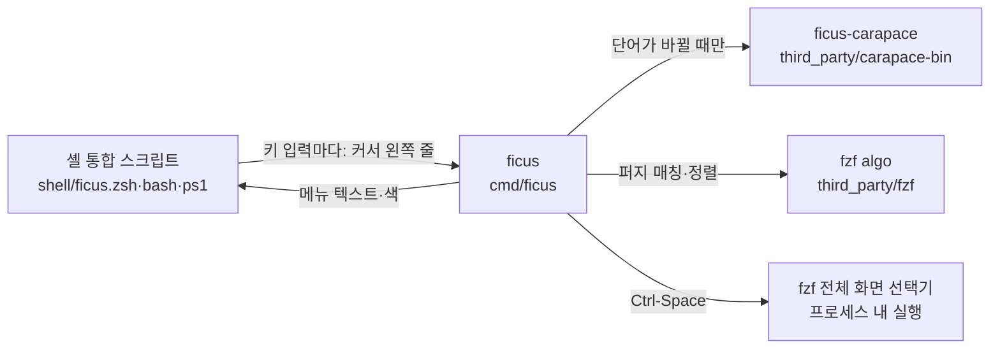

# ficus

Fig 스타일의 **입력 중 자동완성 메뉴**를 터미널 안에 그리는 도구입니다. 별도 GUI 창 없이 셸 자체 기능으로 동작하므로 macOS·Linux·Windows, SSH, tmux 어디서나 같은 방식으로 씁니다.

```
~/project $ git ch
 cherry            Find commits yet to be applied to upstream
 checkout          Switch branches or restore working tree files
 check-attr        Display gitattributes information
 1/26
```

| 셸 | 최소 버전 | 메뉴 표시 방식 |
|---|---|---|
| zsh | 5.9 | `POSTDISPLAY` + `region_highlight` (zle가 직접 그림), 후보 조회는 비동기 (`zle -F`) |
| bash | 4.0 | `bind -x` 키 핸들러 + 커서 기준 ANSI 출력 |
| PowerShell | PSReadLine 2.x | PSReadLine 키 핸들러 + ANSI 출력 |

## 구성



- **ficus** (`cmd/ficus`, `internal/engine`): 줄을 셸 문법대로 파싱하고 (carapace-shlex), 후보를 모아 fzf 알고리즘으로 순위를 매기고, 메뉴를 그려 셸 형식으로 돌려줍니다. 수락 시 셸별 따옴표 처리도 여기서 합니다.
- **ficus-carapace** (`cmd/ficus-carapace`): 수정하지 않은 carapace-bin 빌드입니다. 1000개 이상의 명령 정의를 가진 대신 실행에 약 150ms가 걸려서, 단어가 바뀔 때만 실행하고 결과를 캐시합니다(기본 10초). 같은 단어 안에서 타이핑할 때는 캐시된 후보를 ficus가 퍼지 필터링만 합니다.
- 후보 출처: 명령 위치는 `PATH` 실행 파일 + 셸 별칭·함수·내장 명령, 인자는 carapace, carapace가 모르는 명령은 파일(`-`로 시작하는 단어면 그 명령의 `--help` 출력에서 읽은 플래그), `$VAR`는 환경 변수, PowerShell cmdlet 인자는 PowerShell 자체 `TabExpansion2`.

`third_party/`의 세 프로젝트(carapace-bin, fzf, fzf-tab)는 원본 그대로 git 서브모듈로 들어 있습니다. fzf-tab은 참고용이고 빌드에는 쓰지 않습니다(같은 역할을 `ficus pick`이 모든 셸에서 합니다).

## 설치

### Linux, macOS

```sh
curl -fsSL https://github.com/leechoonguk/ficus/releases/latest/download/install.sh | sh
```

최신 릴리스에서 이 컴퓨터용 압축 파일을 받아 `checksums.txt`로 검증하고, 두 바이너리(`ficus`, `ficus-carapace`)를 `~/.local/bin`에 넣은 뒤 `ficus setup`을 실행합니다. 관리자 권한은 필요 없습니다. 원격 서버에서도 같은 한 줄이면 되고, 클라이언트·tmux 쪽 설정은 필요 없습니다. 환경 변수로 바꿀 수 있습니다: `FICUS_VERSION=v0.1.0`(버전 고정), `FICUS_INSTALL_DIR`(설치 위치), `FICUS_SHELLS=zsh,bash`(대상 셸), `FICUS_NO_SETUP=1`(셸 등록 생략).

### Ubuntu, Debian (.deb)

```sh
curl -fsSLO https://github.com/leechoonguk/ficus/releases/latest/download/ficus_amd64.deb   # ARM: ficus_arm64.deb
sudo apt install ./ficus_amd64.deb
ficus setup          # 사용자 계정으로 (sudo 없이)
```

패키지는 바이너리만 `/usr/bin`에 설치합니다. 셸 설정 파일은 사용자마다 다르므로 각 사용자가 `ficus setup`을 실행합니다. Fedora 등은 같은 위치의 `ficus_amd64.rpm`.

### Windows (PowerShell)

```powershell
irm https://github.com/leechoonguk/ficus/releases/latest/download/install.ps1 | iex
```

`%LOCALAPPDATA%\Programs\ficus`에 설치하고 사용자 PATH에 추가한 뒤, PowerShell 7(`pwsh`)과 Windows PowerShell 5.1의 `$PROFILE`에 등록합니다. 관리자 권한은 필요 없습니다. 서명되지 않은 실행 파일이라 SmartScreen이나 백신이 처음에 경고할 수 있습니다.

### 셸 등록: `ficus setup`

`ficus setup`은 이 컴퓨터에서 지원되는 셸(zsh 5.9+, bash 4+, `pwsh`, Windows의 `powershell`)을 찾아 각 설정 파일 끝에 아래 블록을 넣습니다. 셸이 시작될 때마다(로그인·재부팅 후 포함) ficus가 켜집니다. ficus는 상주 프로세스가 아니라서 부팅 때 따로 실행할 것은 없습니다. 대상 셸을 직접 고르려면 `ficus setup --shells zsh,bash`.

| 셸 | 설정 파일 | 들어가는 줄 |
|---|---|---|
| zsh | `${ZDOTDIR:-~}/.zshrc` | `if [ -x '…/ficus' ]; then eval "$('…/ficus' init zsh)"; fi` |
| bash | `~/.bashrc`, 그리고 로그인 셸이 읽는 `~/.bash_profile`(또는 `.bash_login`/`.profile`)이 `.bashrc`를 읽지 않을 때 그 파일에도 | `if [ -n "$BASH_VERSION" ] && [ -x '…/ficus' ]; then eval "$('…/ficus' init bash)"; fi` |
| PowerShell | `$PROFILE` | `if (Test-Path -LiteralPath '…/ficus') { Invoke-Expression (& '…/ficus' init pwsh \| Out-String) }` |

블록은 `# >>> ficus >>>` … `# <<< ficus <<<`로 감싸며, 다시 실행하면 중복 없이 교체됩니다. 블록에는 `ficus setup`을 실행한 경로(`/usr/bin/ficus`, Homebrew 링크 등)가 들어가므로 업그레이드해도 그대로 동작합니다. 바이너리가 없으면 아무것도 하지 않으므로 셸 시작이 실패하지 않고, 종료 코드도 바꾸지 않습니다. zsh 설정 파일은 zsh에게 물어서 찾습니다(`~/.zshenv`에서 정한 `ZDOTDIR`도 반영). oh-my-zsh 같은 플러그인 매니저보다 뒤에 있어야 하므로, 나중에 설정 파일 끝에 다른 플러그인을 추가했다면 `ficus setup`을 다시 실행해 블록을 맨 끝으로 옮기세요.

`ficus setup --remove`는 등록을 원복합니다. 설정 파일에서 블록과 등록이 덧붙인 빈 줄·줄바꿈만 지워 **파일을 등록 전과 바이트 단위로 같게** 되돌리고(CRLF 파일, 마지막 줄바꿈이 없던 파일 포함. 등록 뒤 다른 프로그램이 파일 끝에 덧붙인 줄은 그대로 둡니다), 등록이 새로 만든 설정 파일은 다른 내용이 없으면 지웁니다. 설정 파일이 심볼릭 링크여도 링크는 유지됩니다. 블록이 깨진 파일(시작 표시만 있고 끝 표시가 없는 등)이 하나라도 있으면 등록·제거 모두 그 파일을 건드리지 않고 오류로 알리며, 등록은 다른 파일도 바꾸기 전에 멈춥니다.

설정 파일은 같은 셸의 여러 버전이 함께 읽습니다(macOS의 `/bin/bash` 3.2와 Homebrew bash 5가 같은 `~/.bashrc`를 읽음). 그래서 지원하지 않는 버전(bash 4 미만, zsh 5.9 미만, PSReadLine 없는 PowerShell)에서 블록을 읽으면 **아무것도 출력하지 않고 건너뛰며**, 설정 파일의 나머지는 그대로 실행됩니다. 자동 감지는 지원 버전이 있는 셸에만 블록을 넣으므로, macOS 기본 bash(3.2)만 있으면 `~/.bashrc`는 건드리지 않습니다. 나중에 bash 5를 설치했다면 `ficus setup`을 다시 실행하세요.

### 제거

| 설치 방법 | 제거 |
|---|---|
| `install.sh` | `ficus setup --remove && rm ~/.local/bin/ficus ~/.local/bin/ficus-carapace` |
| `.deb` | `ficus setup --remove && sudo apt remove ficus` |
| `install.ps1` | `ficus setup --remove`, 그다음 `%LOCALAPPDATA%\Programs\ficus` 폴더 삭제 |
| `make install` | `make uninstall` |

후보 캐시는 OS 사용자 캐시 디렉터리의 `ficus` 폴더(macOS `~/Library/Caches/ficus`, Linux `~/.cache/ficus`, Windows `%LOCALAPPDATA%\ficus`)에 있으며 지워도 됩니다.

### 소스에서 빌드

필요: Go (`go.mod` 버전), git.

```sh
git clone --recursive https://github.com/leechoonguk/ficus && cd ficus   # 이미 받았다면: git submodule update --init --depth 1
make            # bin/ficus, bin/ficus-carapace
make test
make install    # ~/.local/bin(PREFIX=...로 변경)에 복사 + ficus setup (SHELLS="zsh bash"로 대상 선택)
make uninstall  # ficus setup --remove + 바이너리와 캐시 삭제
make dist       # 모든 플랫폼용 릴리스 파일을 dist/에 (GoReleaser 필요, 게시하지 않음)
make verify     # 커밋 전 검사: 하네스 검사 + gofmt/vet + 테스트
```

### 릴리스 만들기

버전은 git 태그(`vX.Y.Z`) 하나뿐이고, 태그는 `make release`로만 만듭니다.

```sh
make release bump=patch DRY_RUN=1   # 확인만: 다음 버전과 나갈 커밋을 보여 주고 아무것도 올리지 않음
make release bump=patch             # patch(수정) | minor(기능 추가) | major(사용자가 바꿔야 할 변경)
```

`make release`는 `make verify` 뒤에 `scripts/release.sh`가 다음을 차례로 하고, 하나라도 실패하면 멈춥니다.

1. `main`이고, 작업 트리가 깨끗하고, `origin/main`과 같고, 그 커밋의 CI(`ci` 워크플로)가 통과했는지 확인합니다(실행 중이면 기다림).
2. 마지막 태그에서 다음 버전을 계산하고(`v0.1.0` + patch → `v0.1.1`) 나갈 커밋 목록을 보여 줍니다.
3. 태그를 만들어 올리면 GitHub Actions(`release.yml`)가 GoReleaser(`.goreleaser.yaml`)로 6개 플랫폼을 빌드해 압축 파일, `.deb`/`.rpm`, `checksums.txt`, `install.sh`, `install.ps1`을 Releases에 올립니다(약 8분). 끝날 때까지 기다립니다.
4. 올라간 파일이 빠짐없는지 확인합니다.
5. `verify-release.yml`로 그 버전을 Ubuntu·macOS(`install.sh`), `.deb`, Windows(PowerShell 7과 5.1, `install.ps1`)에 실제로 설치해 셸 등록·후보·제거까지 확인합니다(약 3분).

잘못된 릴리스는 `make unrelease v=vX.Y.Z`로 지웁니다(GitHub 릴리스와 태그 삭제, `releases/latest`는 이전 릴리스를 가리킴). 이미 공개된 버전 번호는 다시 쓰지 말고 다음 번호로 고쳐 냅니다. 릴리스 노트는 지난 태그 이후 커밋 제목으로 만들어지므로(`docs:`, `test:` 제외) 사용자가 읽을 수 있게 씁니다.

압축 파일 이름에는 버전이 없어서(`ficus_linux_amd64.tar.gz`) `releases/latest/download/...` 주소가 항상 최신 릴리스를 가리킵니다. 사용자는 설치 때 쓴 한 줄을 다시 실행하면 업데이트됩니다.

이 저장소에는 omp 하네스(`.omp/`)가 있습니다. 에이전트가 작업할 때 사용자 요청 없이 커밋·푸시·릴리스하거나, `git tag`·`gh release`로 `make release`를 우회하는 명령은 훅이 막습니다. 릴리스 설정, `scripts/release.sh`, 설치 스크립트, 워크플로가 같은 파일 이름과 저장소를 가리키는지는 `make check-release`(`make verify`에 포함)가 검사합니다. 명령 목록은 `make help`.

## 키

| 키 | 메뉴가 열려 있을 때 | 메뉴가 없을 때 |
|---|---|---|
| Tab | 고른 항목 입력. 고른 게 없으면 모든 후보가 공유하는 앞부분(친 것보다 길 때, 공백 없이), 아니면 첫 항목 (다음 단어 메뉴가 이어서 열림) | 메뉴를 보류 중이면(짧은 명령어, `auto_popup = false`) 메뉴 열기, 아니면 원래 동작 |
| ↓ | 다음 항목 (처음 ↓는 두 번째 항목) | 원래 동작 (히스토리) |
| ↑ | ↓로 고른 뒤에만 메뉴 안에서 이동(`up_arrow = "menu"`면 처음 ↑가 마지막 항목). 그 전에는 히스토리 | 원래 동작 (히스토리) |
| Alt-↓ / Alt-↑ | 다음/이전 그룹의 첫 항목. 그룹이 없으면 한 페이지 | 원래 동작 |
| → (zsh, PowerShell, `ghost = true`) | 줄 끝에 흐리게 보이는 제안을 입력 | 원래 동작 |
| Ctrl-G (모든 셸), Esc (zsh emacs 모드, PowerShell Windows 모드) | 메뉴 닫기 | 원래 동작 |
| Ctrl-Space | fzf 선택기 (모든 후보를 퍼지 검색, 파일이면 미리보기). 사용자의 `FZF_DEFAULT_OPTS`는 적용하지 않습니다 | 같음 |
| Enter | 하이라이트된 항목으로 완성하고 메뉴를 닫음(실행하지 않음). 메뉴는 다음 키를 칠 때까지 닫혀 있어서, 한 번 더 Enter를 치면 실행 | 원래 동작 (실행) |
| Ctrl-C, 커서 이동 키 | 메뉴를 지우고 원래 동작 | 원래 동작 |

Tab, Ctrl-Space, Ctrl-G, Alt-↓/↑는 설정의 `[keys]`로 바꿀 수 있습니다.

메뉴가 뜨면 **첫 항목이 하이라이트**되어 있고(줄 앞의 `>`), Enter는 그 항목으로 완성합니다. 하이라이트가 곧 "Enter가 넣을 항목"입니다. 완성한 뒤 메뉴는 다음 키를 칠 때까지 닫혀 있으므로, 한 번 더 Enter를 치면 그 줄을 실행합니다. 메뉴가 없을 때(후보 없음, 짧은 명령어, Ctrl-G로 닫음) Enter는 친 그대로 실행합니다. 처음 ↓는 두 번째 항목으로, ↑/↓로 고른 항목도 Enter로 완성합니다. 메뉴는 커서가 줄 끝에 있을 때만 따라오며, 커서를 옮기면 닫힙니다. 처음에 아무것도 하이라이트하지 않으려면(Enter는 항상 친 그대로 실행) `preselect = false`.

명령 위치에서는 `min_input`(기본 2)글자를 치기 전과 친 단어가 이미 명령 이름일 때 메뉴를 띄우지 않습니다(첫 글자마다 수백 개가 깜박이지 않도록). 이때 Tab을 누르면 메뉴가 열리고, 그 줄에서는 계속 따라옵니다.

필터를 치지 않은 상태에서 후보에 태그가 둘 이상이면(`git `의 main commands, interrogator commands 등) `── 태그` 머리줄로 묶어 보여 줍니다. 설명이 칸에 다 안 들어가면 선택한(없으면 첫) 항목의 설명을 메뉴 아래에 줄바꿈해 보여 줍니다. 항목 앞의 한 글자는 종류입니다: `>` 명령, `@` 별칭, `f` 함수, `b` 내장, `-` 플래그, `/` 디렉터리, `.` 파일, `$` 변수(`icons = "nerd"`면 Nerd Font 아이콘).

자주 고른 항목은 같은 점수의 후보보다 앞에 옵니다(`recent`, 명령별 최근 기록을 캐시 디렉터리의 `recent.json`에 저장).

예시(파일 `alpha.txt`, `beta.txt`, `gamma.txt`가 있을 때):

| 입력 | 결과 |
|---|---|
| `cat alp` Enter | 줄이 `cat alpha.txt `로 완성됨 (실행 안 함, 메뉴 닫힘) |
| `cat alp` Enter Enter | `cat alpha.txt` 실행 |
| `cat ` Enter Enter | `cat alpha.txt` 실행 (첫 항목) |
| `cat ` ↓ Enter Enter | `cat beta.txt` 실행 |
| `cat ` Ctrl-G Enter | `cat` 실행 (메뉴를 닫음) |
| `cat alp` Enter (`preselect = false`) | `cat alp` 실행 |

## 설정

설정 파일은 `~/.config/ficus/config.toml`입니다(`$XDG_CONFIG_HOME/ficus/config.toml`, Windows는 `%APPDATA%\ficus\config.toml`, `FICUS_CONFIG`로 직접 지정). 모든 키는 같은 이름의 환경 변수(`FICUS_` + 대문자, 예: `FICUS_ROWS=12`)가 우선합니다. 잘못된 값이나 모르는 키는 그 키만 기본값으로 두고, 셸이 시작될 때(`ficus init`) 한 번 알려 줍니다. 셸 쪽 설정(키, `up_arrow`, `auto_popup`, `ghost`, `theme`)은 새 셸에서 적용됩니다.

```toml
rows = 8              # 한 번에 보이는 항목 줄 수 (1-50). 터미널이 낮으면 더 줄어듭니다
details = 3           # 설명 칸에 안 들어가는 설명을 보여 줄 줄 수 (0이면 끔)
groups = true         # 태그별 머리줄
icons = "ascii"       # none | ascii | nerd
min_input = 2         # 명령 위치에서 메뉴를 띄우기 전 글자 수 (0-10)
auto_popup = true     # false: Tab을 눌러야 메뉴가 열림 (화면 낭독기 사용자 등)
preselect = true      # 첫 항목을 하이라이트해 Enter로 완성 (false: Enter는 친 그대로 실행)
up_arrow = "history"  # history | menu: ↓로 고르기 전 ↑가 하는 일
ghost = false         # 줄 끝에 첫(고른) 항목을 흐리게 미리 보이기 (zsh, PowerShell)
recent = true         # 최근 고른 항목을 앞으로
help_flags = true     # carapace가 모르는 명령은 `명령 --help`에서 플래그를 읽음
color = "auto"        # auto | always | never
theme = "ansi"        # ansi | dark | light | auto
ascii = "auto"        # auto | on | off: …, ─ 대신 ..., -
ambiwidth = 1         # 1 | 2: 동아시아 모호 폭 문자를 2칸으로 그리는 터미널이면 2
budget = "60ms"       # bash·PowerShell: 캐시에 없는 후보를 기다리는 최대 시간
ttl = "10s"           # 인자 후보를 새로 조회하는 간격. 지난 결과(하루 이내)는 바로 보여 주고 뒤에서 갱신
picker_preview = true # 선택기에서 파일·디렉터리 미리보기
picker_popup = false  # tmux 3.2+ 안에서 선택기를 팝업으로
disable_for = []      # 메뉴를 띄우지 않을 명령 (환경 변수는 쉼표로 구분)

[keys]                # 빈 문자열은 바인딩하지 않음
accept = "tab"
pick = "ctrl-space"
dismiss = "ctrl-g"
next_group = "alt-down"
prev_group = "alt-up"
```

`[keys]`의 환경 변수는 `FICUS_KEY_ACCEPT`처럼 `FICUS_KEY_` + 대문자입니다. 키 이름: `tab`, `escape`, `ctrl-space`, `alt-space`, `alt-up`, `alt-down`, `ctrl-<글자>`, `alt-<글자>`. `ctrl-c`, `ctrl-i`, `ctrl-j`, `ctrl-m`, `ctrl-x`(bash 통합이 내부적으로 씀)는 쓸 수 없고, 두 동작에 같은 키를 주면 오류입니다.

**색과 글자**: `theme = "ansi"`(기본)는 터미널 팔레트의 기본 8색만 써서 밝은·어두운 테마를 따라갑니다. `dark`/`light`는 256색 고정 팔레트이고, 256색이 안 되는 터미널에서는 `ansi`가 됩니다. `auto`는 셸 시작 때 터미널에 배경색을 물어보고(OSC 11, 최대 150ms), 답이 없으면 `COLORFGBG`를 봅니다. `NO_COLOR`가 비어 있지 않으면(또는 `color = "never"`, 색이 없는 터미널) 색 없이 굵게·밑줄·반전만 씁니다. 선택한 줄은 색과 상관없이 `>`로 표시합니다. 로캘이 UTF-8이 아니거나 `TERM=linux`, `ambiwidth = 2`면 ASCII 글자만 씁니다. `TERM=dumb`(에디터 안의 셸 등)에서는 통합 전체가 꺼집니다.

**`--help` 플래그**: carapace에 정의가 없는 명령(예: `omp`)에서 `-`로 시작하는 단어를 치면 `명령 --help`를 한 번 실행해 플래그와 설명을 읽고, 실행 파일이 바뀔 때까지(최대 하루) 캐시합니다. `--model=<value>`처럼 값을 받는 플래그도 `--model `(공백)으로 넣고, 값은 이어서 칩니다. `--help`를 무시하고 그냥 실행될 수 있는 스크립트(`#!`로 시작하는 파일)와 `./deploy.sh`처럼 경로로 부른 명령은 실행하지 않습니다. 하위 명령의 플래그(`omp agents --…`)는 읽지 않습니다. 끄려면 `help_flags = false`.

**`ficus doctor`**: 설정 파일, 터미널(TERM, 색 수, terminfo 유무, 배경색), 로캘, tmux `escape-time`, VS Code·JetBrains 터미널 충돌, 백엔드·캐시, 키 설정을 점검해 출력합니다.

설정 파일로 옮기지 않은 환경 변수:

| 변수 | 기본값 | 설명 |
|---|---|---|
| `FICUS_CACHE_DIR` | OS 사용자 캐시 디렉터리`/ficus` | 후보 캐시 위치. 하루 지난 항목은 자동으로 지웁니다 |
| `FICUS_CARAPACE` | ficus 옆, 없으면 `PATH` | ficus-carapace 경로 |

## 셸 통합의 동작 원리와 제약

**zsh**: `zle-line-pre-redraw` 훅이 줄 변경을 감지해 비동기로 `ficus complete`를 실행하고, 결과를 `POSTDISPLAY`(줄 아래 텍스트)와 `region_highlight`(`memo=ficus` 태그)로 그립니다. 그리기를 zle가 전담하므로 화면이 어긋나지 않습니다.
- `POSTDISPLAY`를 쓰는 다른 플러그인(zsh-autosuggestions)과는 함께 쓸 수 없습니다. 그 플러그인이 로드되어 있으면 `ghost`는 꺼집니다.
- 붙여넣기(bracketed paste)는 메뉴를 닫고, 입력이 밀려 있는 동안(`PENDING`)은 조회하지 않습니다.
- 터미널 크기가 바뀌면 메뉴를 다시 배치하려고 `TRAPWINCH`를 감쌉니다(`TRAPINT`와 같은 방식으로 기존 트랩을 이어서 실행).
- Esc 단독 입력을 구분하려고 `KEYTIMEOUT`을 10(0.1초)으로 줄입니다.
- Ctrl-C로 줄을 버릴 때 메뉴를 지우려고 `TRAPINT`를 감쌉니다. 기존 `TRAPINT` 함수나 `trap '…' INT`는 이어서 실행하고, `.zshrc`를 다시 읽어도 중복되지 않습니다.
- 메뉴 키는 emacs와 vi 입력 모드 각각에서 원래 위젯을 기억해 메뉴가 없을 때 그대로 실행합니다. vi 입력 모드의 Esc(명령 모드)는 건드리지 않습니다.
- 모든 위젯은 `emulate -L zsh`로 실행되어 사용자의 셸 옵션(`SH_WORD_SPLIT` 등)에 영향받지 않습니다.

**bash**: readline에는 편집 후 훅이 없어서, 출력 가능한 ASCII 키와 Backspace를 `bind -x`로 직접 처리합니다. bash는 `bind -x` 명령 전에 입력 줄을 지우고 커서를 줄 첫 행 0열에 두며(`rl_clear_visible_line`), 끝난 뒤 그 위치에서 줄을 다시 그립니다. ficus는 이 규약에 맞춰 메뉴를 그리고 커서를 원점으로 돌려놓습니다. 줄이 끝나는 화면 행은 엔진이 `${PS1@P}`의 마지막 줄과 입력 줄로 계산합니다(한글 같은 2칸 문자, 붙여넣은 줄바꿈 포함; 터미널 질의 없음 → SSH 왕복 지연 없음).
- 모든 바인딩은 emacs와 vi-insert 키맵에 각각 걸고, vi 명령 모드의 Enter도 메뉴를 지운 뒤 실행합니다(`set -o vi` 지원).
- `set bind-tty-special-chars off`로 바꿉니다(readline이 매 줄 Backspace 바인딩을 tty erase 문자로 덮어쓰는 것을 막음).
- 한글 등 멀티바이트 입력은 readline 기본 입력으로 들어가며, 그 키에서는 메뉴가 갱신되지 않습니다(다음 ASCII 키에서 갱신).
- Tab·↑·↓·Ctrl-G·Alt-↑↓(설정한 키)는 메뉴가 열릴 때만(Tab은 메뉴를 보류 중일 때도) ficus에 묶이고, 닫히면 원래 바인딩(readline 함수, 매크로, atuin 같은 도구의 `bind -x` 명령)으로 되돌아갑니다. 그래서 메뉴가 없을 때 Tab 두 번이 후보 목록을 보여주는 등 원래 동작이 그대로입니다. 메뉴가 열려 있어도 ficus가 감시하지 않는 키(Ctrl-P, Delete, Alt-. 등)로 줄이 바뀌었거나 커서가 끝에 없으면, 메뉴 키는 메뉴를 닫고 원래 동작을 합니다.
- Ctrl-R/Ctrl-S 검색 동안에는 Backspace를 readline에 돌려줍니다(검색은 `backward-delete-char`에 직접 묶인 키만 인식).
- 키 입력이 밀려 있으면(`read -t 0`, 붙여넣기·빠른 타이핑) 그 키에서는 조회하지 않습니다.
- 메뉴는 바뀐 줄만 다시 쓰고, 프레임마다 동기화 출력(`CSI ? 2026 h/l`)으로 감쌉니다.
- `PROMPT_COMMAND` 맨 뒤에 붙고 받은 `$?`를 그대로 돌려주므로, 종료 코드를 보여주는 프롬프트에 영향이 없습니다. 기존 `EXIT` 트랩은 이어서 실행합니다.

**PowerShell**: 출력 가능한 키마다 PSReadLine 핸들러가 `Insert` 후 메뉴를 그립니다.
- 메뉴 때문에 화면이 스크롤되면 PSReadLine 내부 필드 `_initialY`를 같은 만큼 보정합니다(리플렉션).
- ficus는 stdin·stdout·stderr를 모두 리디렉션한 `Process`로 실행합니다. 콘솔을 넘겨받는 자식이 있으면 .NET이 터미널을 cooked 모드로 돌려서, 그 사이에 친 키가 커널 줄 편집을 거치기 때문입니다(예: Ctrl-U가 입력을 지움).
- 입력 줄은 환경 변수로 넘깁니다. Windows 인자 전달은 따옴표를 망가뜨립니다.
- cmdlet·함수·스크립트의 인자는 `TabExpansion2` 결과를 단어당 한 번 받아 같은 엔진으로 순위·표시합니다. 결과는 10초, 또는 명령을 실행할 때까지만 재사용합니다.
- ficus는 PowerShell의 현재 위치(`Set-Location`)에서 실행됩니다. 레지스트리 같은 파일 시스템이 아닌 위치에서는 마지막 파일 시스템 위치를 씁니다.
- ficus가 차지하는 키는 PSReadLine 디스패치 테이블에서 원래 핸들러(기본 함수, 사용자 스크립트 블록, oh-my-posh 같은 모듈의 핸들러)를 그대로 가져와 메뉴가 없을 때 실행합니다. Windows PowerShell 5.1에 들어 있는 PSReadLine 2.0.0도 지원합니다.
- PSReadLine 인라인 예측(회색 글자, PSReadLine 2.2 이상 기본 켜짐)은 ficus 메뉴와 함께 보입니다. 하나만 원하면 `Set-PSReadLineOption -PredictionSource None`. 예측이 켜져 있으면 ficus의 `ghost`는 쓰지 않습니다.
- 가상 터미널 시퀀스를 지원하지 않는 콘솔(구형 conhost)에서는 통합이 꺼집니다. 화면 낭독기 모드(`ScreenReaderModeEnabled`)에서는 Tab으로만 메뉴가 열리고 색을 쓰지 않습니다.
- 키가 밀려 있으면(`[Console]::KeyAvailable`) 조회하지 않고, 메뉴는 바뀐 줄만 다시 쓰며 동기화 출력으로 감쌉니다.
- 선택기(`Ctrl-Space`)는 PowerShell에서 전체 화면으로 뜹니다. 인라인 모드는 터미널에 커서 위치를 묻는데, PSReadLine이 그 응답을 가로챕니다.
- Unix 터미널의 Ctrl-Space는 PSReadLine에서 `Ctrl+@`(Emacs 모드의 SetMark)라서 그 바인딩을 대신합니다.
- Emacs 모드에서 Esc는 Alt 조합의 접두 키라서 건드리지 않고, Ctrl-G로 닫습니다.

## 검증 범위

- macOS: zsh 5.9(oh-my-zsh + powerlevel10k, vi 모드 포함), bash 5.3(emacs·vi 모드, 한글 프롬프트), PowerShell 7.6 / PSReadLine 2.4.5와 2.0.0을 tmux 안에서 실제 키 입력으로 확인했습니다. macOS 기본 bash 3.2에서는 블록이 조용히 건너뛰어지는 것을 확인했습니다.
- Linux: Ubuntu 24.04 컨테이너에서 bash·zsh(로그인 셸 포함)와 셸 등록·제거를 tmux로 확인했습니다.
- Windows: 크로스 컴파일만 확인했습니다. Windows Terminal·conhost에서 실제로 실행해 보지는 않았습니다.
- `make test`: 설정 로드(우선순위, 잘못된 키), 테마·`NO_COLOR`·ASCII 글자, 터미널 높이, 그룹·설명 칸, `min_input`, Tab 공통 앞부분, 최근 기록 순위, 백그라운드 조회 예산, 터미널 배경색 응답 파싱, 엔진(따옴표·`~`·줄바꿈·잘못된 UTF-8 파일 이름이 실제 셸에서 같은 파일을 가리키는지, 캐시 정리 등), 셸 통합 로드(`TERM=dumb`에서는 꺼짐), `ficus setup` 등록·원복(바이트 단위 복원, 깨진 블록 거부, 실제 셸에서 줄이 유효한지)을 검사합니다. GitHub Actions에서 Ubuntu·macOS·Windows로 같은 테스트를 돌립니다.
- 각 단어의 첫 후보 조회는 carapace 시작 비용(약 150–200ms, 처음 실행 시 약 1초) 때문에 느립니다. zsh는 비동기라 입력이 막히지 않습니다. bash·PowerShell은 `budget`(기본 60ms)까지만 기다리고, 그 안에 안 오면 백그라운드 프로세스(`ficus fill`)가 캐시를 채우는 동안 ` loading…`을 보여 줍니다(다음 키에서 후보가 나옴). `ttl`이 지난 캐시는 모든 셸에서 하루까지 바로 보여 주면서 뒤에서 갱신하므로, 한 번 본 단어 위치는 기다리지 않고 바뀐 후보(새 브랜치 등)는 다음 조회부터 나옵니다.

## 업스트림 갱신

```sh
git submodule update --remote --depth 1
make clean build test
```

carapace-bin과 fzf는 MIT 라이선스입니다(`third_party/*/LICENSE`).
